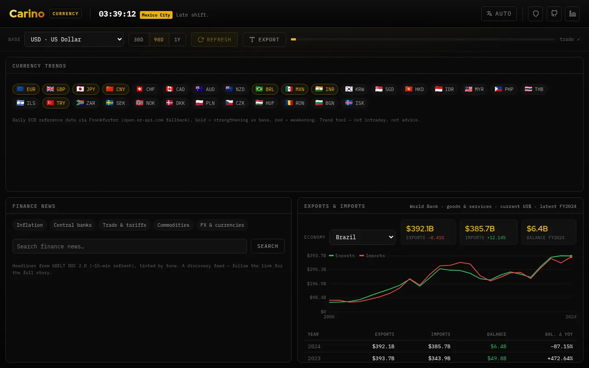

# Carino Currency

A keyless, in-browser finance watcher — part of the [Carino](https://carino.systems) fleet.
Live at **[currency.carino.systems](https://currency.carino.systems)**.



Three pillars, all from public keyless + CORS-friendly sources, computed entirely in your browser (nothing is uploaded, no API key required):

- **Currency trends & movers** — daily FX vs a base currency over 30 / 90 / 365 days, with sparklines and top strengthener/weakener callouts. Source: [Frankfurter](https://frankfurter.dev) (ECB reference rates), with `open.er-api.com` as a wider-coverage fallback.
- **Finance news** — a headline discovery feed you can filter by topic or free-text query (currencies, inflation, central banks, commodities, trade), tinted by article tone where available. Source: [GDELT DOC 2.0](https://blog.gdeltproject.org/gdelt-doc-2-0-api-debuts/).
- **Exports & imports** — a country's export/import value and trade balance in current US$, as multi-year trends with year-over-year deltas. Source: the [World Bank Indicators API](https://data.worldbank.org).

## Design notes

- Vanilla ES modules, no build step, no dependencies, no CDNs — a static site.
- FX is daily ECB data (~16:00 CET on working days) and World Bank trade is annual (≈1-year lag): this is a **trend** tool, not an intraday or trading tool, and not investment advice.
- Per-commodity / per-HS-code trade detail (UN Comtrade, IMF) is intentionally out of scope for the keyless MVP — those sources are not CORS-accessible from a static page and would need a proxy.
- Shares the fleet's self-injecting navbar + clock, fonts, and chart primitives (`viz.js`) with the other Carino projects.
- Translated the fleet way: `carino-lang.js` owns the preference (`?lang` > `.carino.systems` cookie > browser > `en`) and
  `i18n.js` owns this app's dictionary, with the English string as the key. The three pillars render from JS, so they reach
  the dictionary through `T()`/`Tf()` in `util.js` and repaint via `window.onLanguageApplied` — replayed from the TTL cache,
  so switching language costs no network.
- Currency and country **names** are deliberately not in `i18n.js`. `Intl.DisplayNames` already ships CLDR's in every locale,
  so `util.js` asks the browser and keeps the English `name` in `data/` only as a fallback (and for `EMU`, which is a currency
  zone rather than a region). That is what the `iso2` on each country is for. The GDELT query built in `activeQuery()` stays
  English on purpose — it is sent to an English news index, not shown to anyone.

## Structure

```
index.html                 shell + DOM contract
carino-navbar.js           shared fleet navbar (self-injecting; loads carino-clock.js)
carino-lang.js             shared fleet language preference + switcher
i18n.js                    this app's dictionary (es / pt-BR / ja / ru)
assets/css/currency.css    fleet theme
assets/js/
  app.js                   orchestrator (base/window controls, full refresh, export)
  util.js                  DOM/format helpers, TTL cache, T() + Intl display names
  state.js                 settings + shared report
  viz.js                   sparkline + line chart (shared)
  fx.js                    FX trends + movers  (Frankfurter)
  news.js                  finance news        (GDELT)
  trade.js                 exports/imports     (World Bank)
  data/currencies.js       currency universe
  data/countries.js        trading economies
```

## Licensing

**Mine — GNU Affero General Public License v3.0 or later.** Everything in this
repository *except* the paths listed below. Copyright © 2026 Miguel Carino.
Full terms in [LICENSE](LICENSE).

**Not mine.** The files below are third-party works redistributed here. This
project's licence does not cover them and could not: they are not mine to
relicense. Each keeps its own terms, and each carries its own notice.

| Path | What it is | Licence | Notice |
| --- | --- | --- | --- |
| [`fonts/`](fonts/) | IBM Plex Mono, IBM Plex Sans, Red Hat Display | SIL OFL 1.1 | [`fonts/OFL.txt`](fonts/OFL.txt) |

Those files travel with any fork, mirror or repackaging of this repository, and
their notices must travel with them.
